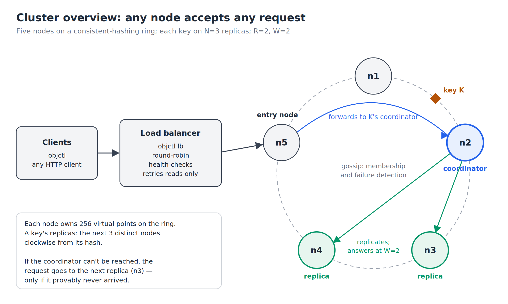
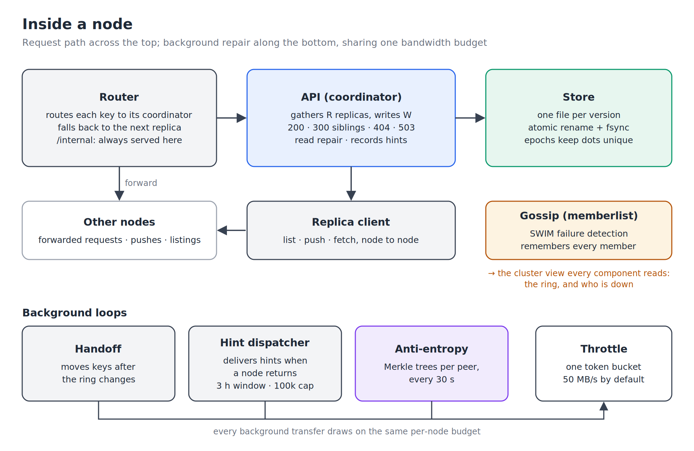
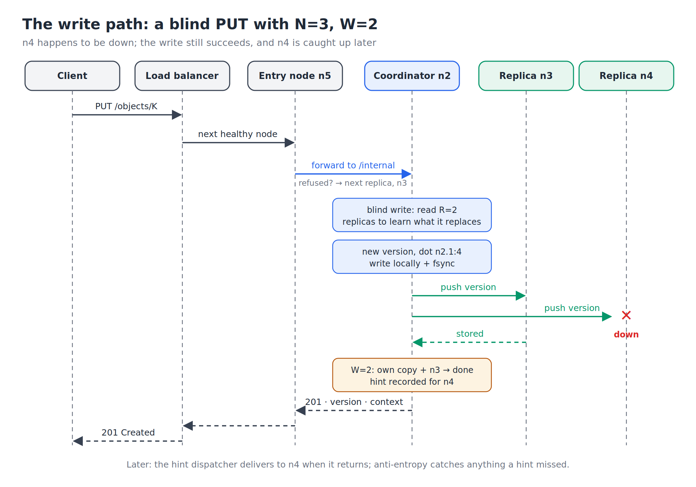
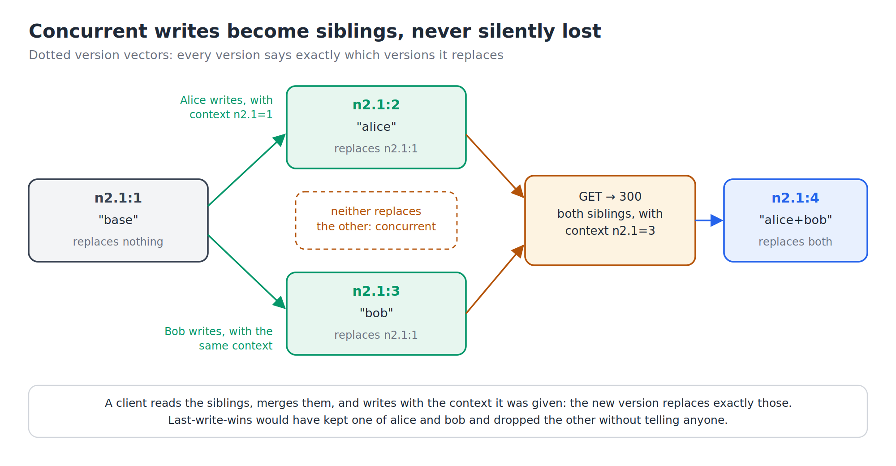
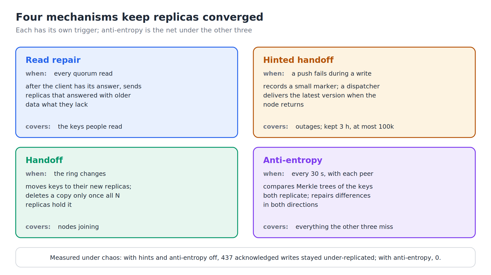
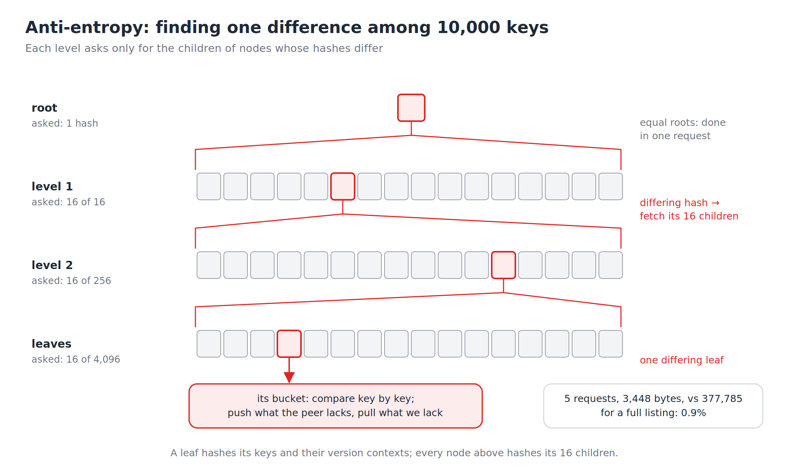

# objstore

A Dynamo-style distributed object store, written from scratch in Go.

Keys are spread over a consistent-hashing ring and kept on N replicas, with tunable read and write
quorums, strict or sloppy. Any node accepts any request. Concurrent writes are tracked with **dotted version vectors**,
so they're kept side by side as siblings instead of one silently overwriting the other. Four
separate mechanisms bring replicas back in step after failures. A chaos harness runs the real
binaries through crashes and freezes, and checks afterwards that nothing it was promised was lost.

**Measured results**

- **0 of 12,790 acknowledged writes lost** across 41 injected node crashes and freezes, on real
  processes. The checker plants a fabricated write in every run, which it must report lost, to prove
  it can detect loss.
- **Anti-entropy** brought acknowledged writes left under-replicated after failures from **437 to 0**,
  and finds one differing key among 10,000 using **0.9%** of the bytes of a full key listing.
- **A coordinator crash** failed **592** requests before replica fallback was added; with it, **1**.
- **Sloppy quorums**: with two of five nodes killed, strict quorums answered **3,011** requests 503;
  sloppy quorums answered **0**, and every stand-in copy went back to its replicas once they returned.
- **306 tests**, all run under Go's race detector. Each feature was also checked by deliberately
  breaking it and confirming a test fails.

---

**Contents:** [Quick start](#quick-start) · [Architecture](#architecture) ·
[Design decisions](#design-decisions-and-their-trade-offs) · [Testing](#testing) ·
[Benchmarks](#benchmarks) · [HTTP API](#http-api) · [Configuration](#configuration) ·
[Repository layout](#repository-layout) · [Limitations](#limitations-and-future-work) ·
[References](#references)

## Quick start

Needs Go 1.22 or later and `curl`. `scripts/cluster.sh` runs on Linux (it reads `/proc`); the node
itself builds anywhere.

```bash
git clone https://github.com/Crpedeim/ObjectStore && cd ObjectStore/objstore

scripts/cluster.sh start --nodes 5 --n 3 --r 2 --w 2   # five nodes, plus a load balancer on :8080
export PATH=$PWD/bin:$PATH

echo "hello, world" | objctl put greeting
objctl get greeting
objctl members

scripts/cluster.sh kill n3      # SIGKILL a node: reads and writes carry on
objctl get greeting
scripts/cluster.sh revive n3    # it comes back and is caught up
scripts/cluster.sh stop
```

`cluster.sh start` saves N, R and W in `data/config`, and `add` and `revive` reuse them, so every
node agrees. Add `--sloppy` to turn on [sloppy quorums](#sloppy-quorums). Run `scripts/cluster.sh`
alone for all its commands and options.

**Conflicts.** Two writes that start from the same version are concurrent, and both are kept:

```console
$ objctl get doc
doc has 2 concurrent versions:
  n2.1:2  (6 bytes)
  n2.1:3  (4 bytes)
read one:  objctl get -version VERSION doc
resolve:   objctl put -context n2.1=3| doc FILE
$ objctl get -version n2.1:2 doc
alice
$ echo alice+bob | objctl put -context 'n2.1=3|' doc
stored doc: version n2.1:4, on 2 replicas
context: n2.1=4|
$ objctl get doc
alice+bob
```

`objctl` exits 0 on success, 1 for not found, 2 for an error, 3 for a conflict, and 4 when too few
replicas answered, so scripts can tell them apart.

## Architecture



Every node runs the same binary and accepts every request. The node a request reaches finds the
key's replicas on the ring (the next N distinct nodes clockwise from the key's hash, with 256
virtual points per node) and forwards it to the key's **coordinator**: the first of those replicas
that gossip doesn't report as down. Sending every write for a key to one node means writes to a key
normally meet in one place, which keeps siblings rare.

Gossip takes a few seconds to notice a crash. Meanwhile, if forwarding fails in a way that proves
the coordinator never received the request, the request goes to the next replica instead. A write
that may have arrived is never sent to a second replica; reads, which change nothing, always may be.



Inside a node, requests flow across the top. The **router** picks the coordinator. The **API**
coordinates reads and writes. The **store** holds one file per version. Membership comes from
**gossip** (SWIM failure detection, through HashiCorp's memberlist), and every component reads it as
an immutable snapshot of the ring and who is down. Three background loops repair replicas, and all
three draw on one per-node bandwidth budget, so repair can't swamp live traffic.

### Writes and reads



A write without a context is **blind**: the coordinator first reads R replicas to learn what it
replaces, then creates a new version, stores it with fsync, and pushes it to the other replicas. It
answers once **W** replicas hold it, its own copy included. A replica that couldn't be reached gets a
**hint**, delivered later. A write carrying a context, from an earlier read, skips the quorum read
and replaces exactly what that context names.

A read gathers **R** replicas' versions and returns the newest, or every concurrent one as siblings
(HTTP 300). Then, in the background, it sends any replica that answered with something older what
it lacks.

If R + W > N, every read quorum overlaps every write quorum, so while nodes agree on the ring, a read
sees every acknowledged write. `cluster.sh` warns when you choose settings that don't satisfy that.

### Sloppy quorums

By default quorums are strict: only a key's own N replicas count, so with two of three down, its
reads and writes answer 503. Start nodes with `-sloppy` (`cluster.sh start --sloppy`) and a replica
that can't be reached is replaced by a **stand-in**: the next node clockwise past the key's N
replicas that gossip doesn't say is down, as in Dynamo. A stand-in's copy counts toward W and its
answer toward R, but only in place of a replica that is down or has failed, and only once every
replica gossip calls healthy has answered or failed: while a key's own replicas can make the
quorum, they do. (A stand-in usually holds nothing for the key; counting its empty answer over a
healthy replica's could make a key that exists read as missing.) A replica gossip already calls
down gets a stand-in at once, without waiting for a frozen node's timeout, and is still pushed to
in case gossip is wrong. With every replica down, the router sends the request to a stand-in, which
coordinates it.

Handing the copies back needs no new mechanism: a stand-in holds the key outside its replica set,
so handoff delivers it to all N replicas when they return, and deletes the stand-in's copy only
once all N have it. Read repair never gives a stand-in a copy.

The trade: writes stay available while most of a key's replicas are down, but R + W > N no longer
guarantees a read sees every acknowledged write, until the stand-ins have handed their copies back;
and blind writes through two coordinators, a replica and a stand-in, become siblings. Nothing
acknowledged is lost either way: the chaos harness checks sloppy runs the same as strict ones.

```console
$ scripts/cluster.sh start --sloppy
$ scripts/cluster.sh kill n2; scripts/cluster.sh kill n4   # two of greeting's replicas
$ echo still writable | objctl put greeting
stored greeting: version n3.1:2, on 2 replicas
$ scripts/cluster.sh revive n2; scripts/cluster.sh revive n4
# n1 and n5 stood in; a second later they have handed greeting back and dropped it
```

### Concurrent writes: dotted version vectors



Every version carries a **dot**, a unique (node, counter) pair, and a **past**, the set of versions
it replaces. A version is dropped only when another version's past contains its dot. Two writes
from the same starting point therefore both survive, and a client resolves them by writing with the
context it was given. Last-write-wins would have kept one and dropped the other without telling
anyone. Dots stay unique across restarts because each node starts a new **epoch** every time it
opens its store. A node that comes back with an empty disk under a name the cluster knows — the
member list a seed sends as it joins says so — starts its epochs from the clock instead of from 1,
past any its old self can have used; otherwise its writes would reuse old dots, and replicas holding
those would drop the new writes as duplicates.

### Staying converged



Each repair mechanism has its own trigger, and anti-entropy catches whatever the other three miss.
The chaos harness measured why it matters: with hints and anti-entropy both off, 437 acknowledged
writes stayed on fewer than N replicas after healing; with anti-entropy on, none did.

**Hints** are small markers, not copies of the data. The coordinator is always a replica, so it
already holds the value. A dispatcher delivers each node's hints when gossip says it's back. Hints
expire after 3 hours, and at most 100,000 are kept; past either limit, anti-entropy repairs instead.

### Anti-entropy



Every 30 seconds, each node compares its replicas with each peer's, using a Merkle tree over the
keys **both** replicate. A leaf hashes its bucket's keys and their version contexts, and two replicas
hold the same versions of a key exactly when their contexts match. The exchange descends only into
subtrees whose hashes differ, then repairs each differing key in both directions. The tree pays off
when differences are rare. When many keys differ it costs more than a full listing, as
[the benchmarks](docs/benchmarks/RESULTS.md) show.

### Durability

A version is written to a temporary file and fsynced, hard-linked into place, and its directory
fsynced, all before any version it replaces is deleted. A crash at any point leaves the old
versions, the new one, or both, never neither; when both survive, the new version's past says it
replaces the old. Handoff deletes a node's copy of a key only once all N of
the key's replicas hold everything it held.

## Design decisions and their trade-offs

| Decision | Why | What it costs |
|---|---|---|
| Leaderless replication (Dynamo), not Raft | Any replica can take writes; no election pauses | Concurrent writes must be resolved: siblings |
| Dotted version vectors, not last-write-wins | No acknowledged write is ever silently dropped | Clients may have to merge siblings |
| Coordinator = first live replica | Writes to a key meet at one node, so siblings are rare | A crash briefly redirects that key's traffic |
| Fall back to the next replica only when a request provably never arrived | Survives the failure-detection window without double-applying writes | One failed write per in-flight request at the moment of a crash |
| Strict quorums by default, sloppy on request | Strict: acknowledged means stored on W of the key's own replicas | Strict: with too many replicas down, writes answer 503. Sloppy: they succeed, but a read may miss them until stand-ins hand back |
| Stand-ins hand back through handoff, not a new hint type | Handoff already moves keys a node shouldn't hold, and deletes only once all N have them | A stand-in's copy waits for every replica, not just the one it replaced |
| Hints as markers, not copies | The coordinator already holds the value | A hint is lost if its coordinator's disk is |
| One file per version, fsynced | Simple and crash-safe | Several fsyncs and file operations per write |
| HTTP and JSON between nodes | Every call can be inspected with `curl` | Per-request overhead on every hop |
| Merkle trees rebuilt for each exchange | No tree state to keep consistent with writes | Each exchange walks the store |

## Testing

```bash
go test -race ./...
```

**306 tests** in 17 packages, all run under the race detector. They cover single components (the
store, version vectors, the ring), in-process clusters with network partitions simulated by
switches, and whole nodes gossiping and crashing in one process.

Each feature was also checked by **breaking it on purpose**: changing one line, such as skipping a
fsync, pulling instead of pushing, or retrying a write that may have arrived, and confirming that a
test fails. Where a break went undetected, a test was added or tightened.

**The chaos harness** runs the real node binary as separate processes:

```bash
go build -o bin/node ./cmd/node && go build -o bin/chaos ./cmd/chaos
bin/chaos -duration 60s
bin/chaos -duration 60s -sloppy   # the same, with sloppy quorums
```

Clients write, delete and read through random nodes while a nemesis `kill -9`s or `SIGSTOP`s a node
every few seconds. Afterwards the cluster heals, and the harness checks, using the dots the cluster
returned:

- **lost**: an acknowledged write that no node holds and nothing has replaced;
- **invisible**: an acknowledged write that a quorum read doesn't reflect;
- **stale reads**: a read that missed a write acknowledged before it began;
- **under-replicated**: an acknowledged write missing from one of its key's replicas;
- **duplicate dots**: two acknowledged writes sharing a dot.

It also plants a fabricated acknowledgement, which must be reported lost; if it isn't, the run is
invalid. Run against deliberately broken builds, it caught a coordinator that discarded its own copy
(1,459 writes lost) and replicas that acknowledged without storing (every write under-replicated).
It exits 1 if any check fails. With `-sloppy` it also reports how many keys a stand-in still holds
after healing, which should be none.

**Bugs found later, and fixed.** A review of the whole code and stress runs of the suite found
these; each fix has a test that fails without it.

- **A read could miss a key being overwritten.** The store reads without a lock, and a directory
  listing taken during a write can name neither the old version nor the new one, so the key read as
  empty. Reads now check a per-key change counter and list again if a write overlapped them. The test
  failed 80 runs in 80 under load.
- **Sloppy reads could miss existing keys.** The first version of sloppy quorums let stand-ins' empty
  answers make a quorum while healthy replicas were still answering: the end-to-end sloppy test
  failed 19 runs in 24 under load. Stand-ins now count only in place of replicas that can't answer.
- **A create-only `PUT` could replace a write it never saw.** `If-None-Match: *` checked a quorum,
  then wrote blind, replacing whatever had arrived in between, and both writers got 201. It now
  checks again under the key's lock and answers 412.
- **A node back with an empty disk reused version names**, and its writes were acknowledged but
  dropped by replicas as duplicates. See the epochs above.
- **A hint could be lost while its replica's hints were being delivered**: reading them deleted the
  temp file of a hint still being written. The test failed on its first hint.
- **One oversized version made its key unreadable.** A version whose past was too long for a version
  file was stored anyway, then read back as corrupt by every read and write of the key. It is now
  refused.
- **One damaged file stopped handoff and anti-entropy for the whole node**: both walk the store, and
  stopped at the first file they couldn't read. They now skip it, report it, and carry on.
- **The load balancer waited forever on a frozen node.** It now gives up after 30 seconds without
  response headers: a read goes to another node, a write fails.

## Benchmarks

Full results, method and caveats: [docs/benchmarks/RESULTS.md](docs/benchmarks/RESULTS.md).

> **Measured on a single shared CPU core**, with every node, the load balancer and the load generator
> on one machine. The numbers show relative costs, not what a real cluster would do.

| What | Result |
|---|---|
| One client, N=3, R=2, W=2 | read 1.4 ms, write 5.5 ms (p50) |
| Each extra write acknowledgement (W) | about +0.8 ms (p50) |
| The quorum read before a blind write | about 0.5 ms, ~7% of a write |
| Value size | the same operation rate from 1 KiB to 64 KiB; 74 MB/s at 1 MiB |
| One difference among 10,000 keys | 5 requests, 3,448 bytes, against 377,785 for a full listing |
| A coordinator crash, 4 clients | 592 failed requests before replica fallback; 1 after |
| Two of five nodes down for 10 s, 4 clients | 3,011 requests answered 503 with strict quorums; 0 with sloppy |

A CPU profile found no single hotspot. The disk path is the largest share, with fsync about 18% of a
node's CPU, so batching fsyncs would be the first optimization. Run any case yourself with
`scripts/bench.sh`, and summarise results with `bin/objbench -report`.

## HTTP API

| Request | Answers |
|---|---|
| `GET /objects/{key}` | 200 the value · 300 concurrent siblings (JSON list) · 404 none or deleted · 503 too few replicas |
| `GET /objects/{key}?version=V` | 200 that sibling's value |
| `PUT /objects/{key}` | 201 once W replicas (or, sloppy, stand-ins) have it · 503 fewer did: it may still be stored, and spread |
| `PUT` with `If-None-Match: *` | 201, or 412 if a live value exists, including one written while it checked |
| `DELETE /objects/{key}` | 204 once W replicas have the tombstone · 404 nothing to delete |
| `GET /cluster/members` | every node, its address, and whether it's alive |
| `GET /cluster/owner/{key}` | the key's replicas, in order, and its coordinator now: with `-sloppy`, a stand-in when every replica is down |
| `GET /healthz` | 200 |

Headers: `X-Objstore-Context` on every response describing a key is everything the client has now
seen. Send it back with a `PUT` or `DELETE` to replace exactly those versions; without it a write is
blind. `X-Objstore-Version` is the dot of the version returned or written, and `X-Objstore-Acks`
how many replicas stored a write. Keys may contain slashes, and values stream in both directions.

Nodes talk to each other under `/internal/`: `/internal/versions/{key}` to list, push and fetch exact
versions on that node's own disk, and `/internal/ae/` for anti-entropy. The `internal/client`
package is a small Go client for the public API.

## Configuration

`bin/node` flags:

| Flag | Default | Meaning |
|---|---|---|
| `-id` | (required) | node identifier |
| `-data` | (required) | data directory |
| `-listen` | `127.0.0.1:8080` | HTTP address to listen on |
| `-advertise` | `-listen` | HTTP address peers use to reach this node |
| `-gossip` | `127.0.0.1:7946` | gossip address |
| `-join` | | gossip addresses of existing members, comma-separated; empty founds a new cluster |
| `-vnodes` | 256 | virtual nodes per physical node |
| `-n`, `-r`, `-w` | 3, 2, 2 | replicas per key; replicas a read waits for; replicas a write waits for |
| `-transfer-mb` | 50 | background transfer budget (handoff, hints, anti-entropy) in MB/s; 0 is unlimited |
| `-anti-entropy` | 30s | how often to compare replicas with each peer; 0 turns it off |
| `-hint-window` | 3h | how long a hint is kept before anti-entropy is left to repair |
| `-max-hints` | 100000 | the most hints kept at once; below zero is no limit |
| `-handoff-interval` | 30s | how often handoff sweeps between membership changes |
| `-hints` | true | record hints for missed replicas; false only for experiments |
| `-sloppy` | false | sloppy quorums: nodes past a key's replicas stand in for unreachable ones |

## Repository layout

| Path | What it is |
|---|---|
| `cmd/node` | the node binary |
| `cmd/objctl` | command-line client, and `objctl lb`, the load balancer |
| `cmd/chaos` | the chaos harness |
| `cmd/objbench` | the load generator and report tool |
| `cmd/ringstat` | measures how evenly the ring spreads keys, and how many move when it changes |
| `internal/store` | one file per version; crash-safe writes; epochs |
| `internal/version` | dotted version vectors: dots, contexts, resolving siblings |
| `internal/ring` | consistent hashing with virtual nodes; preference lists |
| `internal/cluster` | immutable membership views, and their holder |
| `internal/gossip` | SWIM membership through memberlist; remembers every member |
| `internal/router` | routing to the coordinator, fallback to the next replica |
| `internal/api` | the coordinator: quorums, siblings, read repair, hints |
| `internal/replica` | the node-to-node client |
| `internal/handoff` | handoff after ring changes, the hint store and dispatcher |
| `internal/antientropy` | Merkle-tree replica synchronization |
| `internal/throttle` | the shared bandwidth budget |
| `internal/stall` | abandons transfers that stop moving bytes |
| `internal/fsutil` | atomic file writes and directory fsync |
| `internal/node` | wires a node together |
| `internal/lb`, `internal/client` | the load balancer and the Go client |
| `internal/chaos`, `internal/bench` | the chaos harness and the load generator |
| `scripts/cluster.sh`, `scripts/bench.sh` | run a local cluster; run benchmark cases |
| `docs/` | diagrams and benchmark results |

## Limitations and future work

- **Sloppy reads can be stale.** With `-sloppy`, a read during an outage may miss a write that only
  stand-ins hold, until they hand it back. Riak-style per-request choice of strict or sloppy would
  let each client pick.
- **Deletes leave tombstones forever.** Nothing reaps them, so a deleted key keeps a small version on
  every replica, and anti-entropy keeps comparing it.
- **Version contexts only grow.** A context names every epoch of every node that has written the key,
  and a node starts an epoch on each restart and each handoff pass that moves keys. Nothing prunes
  them; a key whose version would outgrow a version file's 64 KiB limit refuses further writes.
- **Recognising a node back with an empty disk needs a node that knew it** to be reachable as it
  joins. Give a rebuilt node a new name to be sure.
- **No group commit.** Every write pays its own fsyncs; batching them is the clearest performance win.
- **No decommissioning.** A node that leaves for good stays in the ring; there's no command to
  remove it and rebalance.
- **Anti-entropy trees are rebuilt each exchange**, and cost more than a full listing when many keys
  differ. Incrementally maintained trees, and streaming whole ranges when much differs, would fix both.
- **HTTP and JSON between nodes**, and clients that don't know the ring, add a hop and per-request
  overhead. A binary protocol and ring-aware clients would remove them.
- **No authentication or TLS.** Run it only on a trusted network.
- **Tested on one machine.** The chaos harness uses real processes, but no real network
  partitions. Jepsen would be the next step.

## References

- DeCandia et al., *Dynamo: Amazon's Highly Available Key-value Store*, SOSP 2007.
- Almeida et al., *Scalable and Accurate Causality Tracking for Eventually Consistent Stores*
  (dotted version vectors), DAIS 2014.
- Das, Gupta and Motivala, *SWIM: Scalable Weakly-consistent Infection-style Process Group
  Membership Protocol*, DSN 2002.
- Dadgar, Phillips and Currey, *Lifeguard: Local Health Awareness for More Accurate Failure
  Detection*, 2018.
- Martin Kleppmann, *Designing Data-Intensive Applications*, chapters 5 and 6.
